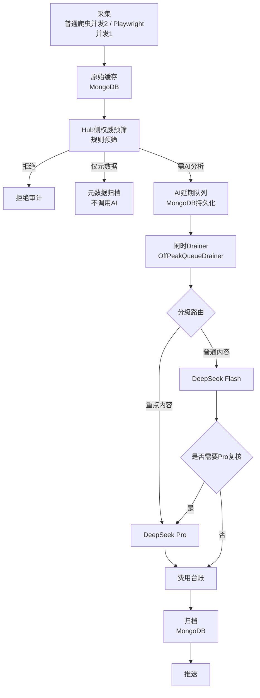

# 美国涉华公开信息监测系统 — 数据流文档（M0）

> 状态：M0 开发护栏与架构文档（当前里程碑）
> 本文件描述目标数据流，M1—M9 为计划事项，尚未实施。

## 1. 数据流总览

```
采集（爬虫，并发2）
  → 原始缓存（MongoDB）
  → Hub侧权威预筛（规则预筛）
      ├─ 拒绝 → 拒绝审计
      ├─ 元数据归档（不调用AI）
      └─ AI延期队列（MongoDB持久化）
          → 闲时Drainer（OffPeakQueueDrainer）
          → DeepSeek Flash（普通内容）
              └─ 重点内容 → DeepSeek Pro（复核）
          → 费用台账
          → 归档（MongoDB）
          → 推送
```

## 2. Mermaid 图示



## 3. 阶段说明

### 3.1 采集

- 普通爬虫并发为 2。
- Playwright 并发为 1。
- 采集结果先写入原始缓存（MongoDB），不直接提交 AI。

### 3.2 原始缓存

- 原始采集数据落库 MongoDB，作为后续处理的数据源。
- 支持幂等：同一数据重复采集不得产生重复处理。

### 3.3 Hub 侧权威预筛

所有来源数据必须先经过 Hub 侧规则预筛，才能进入 AI 延期队列：

| 结果 | 去向 | 是否调用 AI |
|------|------|------------|
| 拒绝（敏感词、参数错误等） | 拒绝审计 | 否 |
| 仅元数据 | 元数据归档 | 否 |
| 需 AI 分析 | AI 延期队列 | 是（闲时） |

- 预筛规则统一由 Hub 管理，可配置，不得硬编码。
- 爬虫侧不执行最终判定。

### 3.4 AI 延期队列

- 使用 MongoDB 持久化，进程重启后队列不丢失。
- 队列项包含：原始数据引用、优先级、入队时间、重试次数、状态。
- 支持按时间窗口批量取出（供闲时 Drainer 消费）。
- 幂等：同一数据重复入队不得产生重复 AI 调用。
- 租约机制：处理中项带租约，超时自动释放。
- 并发认领：同一项不得被两个 worker 同时认领。

### 3.5 闲时 Drainer（OffPeakQueueDrainer）

- 仅在非高峰时段消费 AI 延期队列。
- 受 Guard 窗口约束（见峰谷策略）。
- 与旧 AI Worker 互斥，不得同时启用。

### 3.6 DeepSeek Flash/Pro 分级路由

- 普通内容使用 DeepSeek Flash。
- 重点内容（预筛规则标记）使用 DeepSeek Pro 复核。
- Flash 分析后如需复核，再走 Pro。
- 分级策略配置化，业务代码不得写死。

### 3.7 费用台账

- 每次真实 API 调用记录：时间、模型、Token 用量、费用。
- 用于预算限制与审计。
- M1—M2 默认不产生真实 API 调用。

### 3.8 归档与推送

- 分析完成的结果归档到 MongoDB。
- 推送服务从归档中获取高价值情报推送（M6 实施）。

## 4. 峰谷时段对数据流的影响

| 阶段 | 高峰时段 | 非高峰时段 |
|------|---------|-----------|
| 采集 | 继续 | 继续 |
| 预筛 | 继续 | 继续 |
| 去重 | 继续 | 继续 |
| 存储与排队 | 继续 | 继续 |
| DeepSeek Flash/Pro 调用 | **0** | 按 Guard 窗口执行 |
| API 重试 | **0** | 按 Guard 窗口执行 |
| 付费健康检查 | **0** | 按 Guard 窗口执行 |

## 5. 待核验项

- M4 首批 8 个来源的具体清单：待核验。
- M5 PDF 处理的具体流程：已核验（2026-10-29）。安全校验组件 `ServiceComponent/PdfSecurityValidator.py` 已实现并有离线测试（test_m8_pdf）；但主仓库当前不存在 PDF 下载/内容提取流程（采集链路仅处理 RSS/HTML 文本，`CollectedData.content` 为 str 无二进制通道，china_watch 来源均为 RSS，`pdf_worker` 配置暂无生产代码消费），validator 暂未接入生产链路。待 PDF 采集流程落地时，在"下载落盘后、内容提取前"调用校验，失败记中文 warning（含 URL 与原因）并跳过该条，不中断整轮抓取；调用示例见该组件 docstring。
- M6 推送渠道：待核验。
- M7 四容器部署的端口与网络细节：待核验。